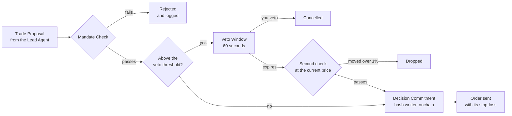
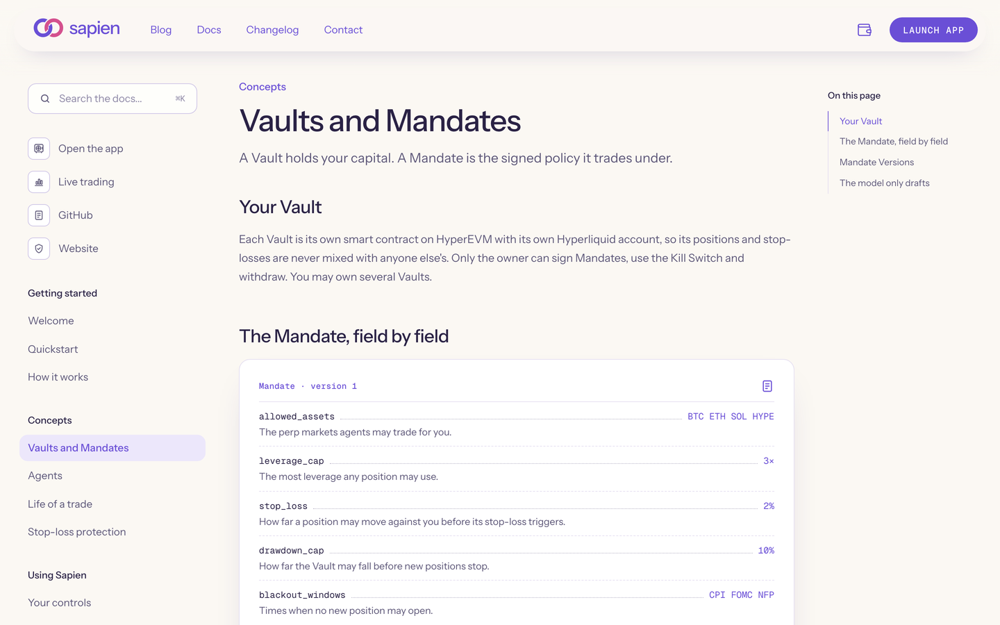
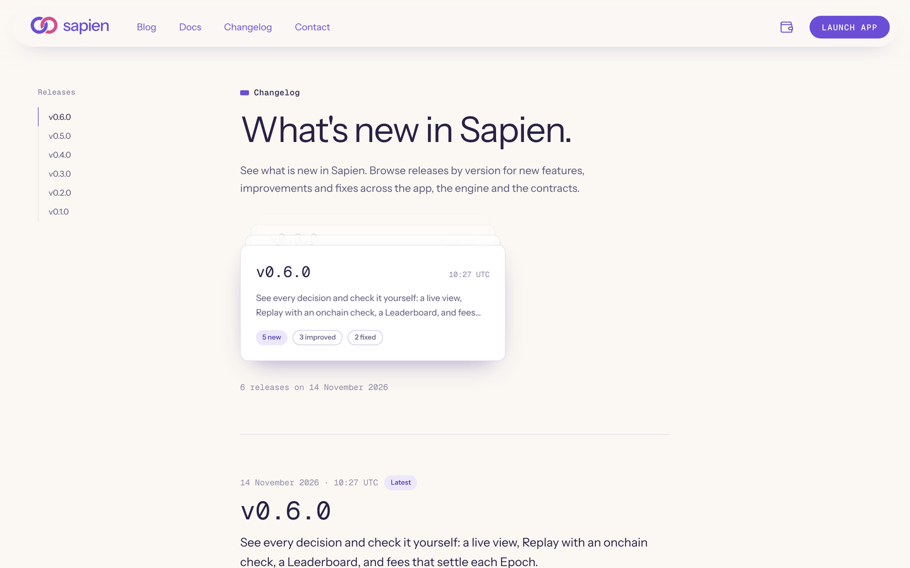
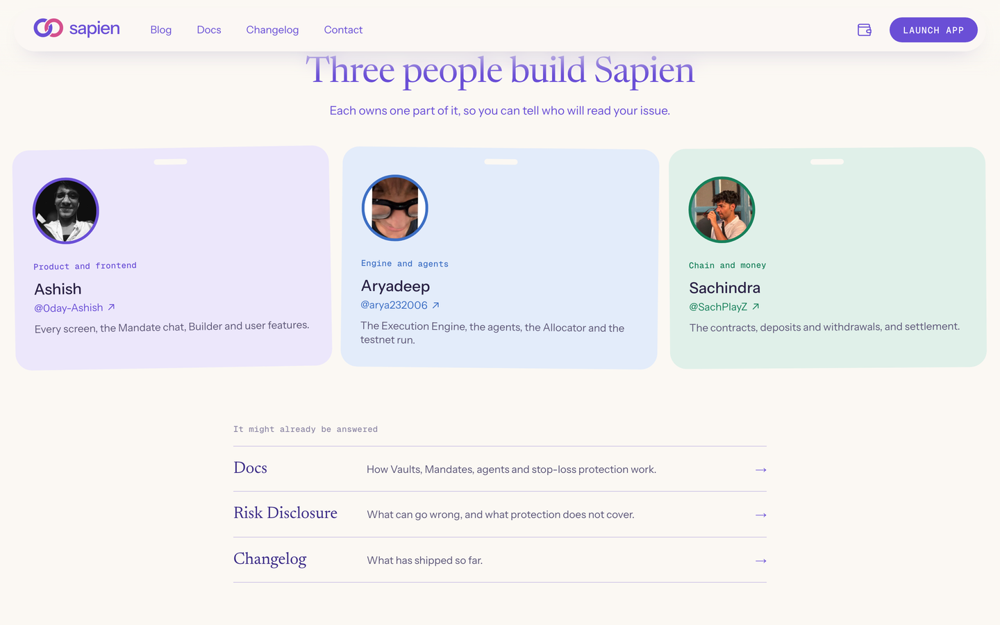

<div align="center">

<a href="https://sapien-omega.vercel.app">
  
</a>

### AI agents can trade your perps. Make them put their money first.

Bonded AI agents trade your Hyperliquid Vault under a Mandate you sign.<br />
Plain-English rules, bonded agents and stop-loss protection, in one Vault.

[**Live app**](https://sapien-omega.vercel.app) ·
[Docs](https://sapien-omega.vercel.app/docs) ·
[Changelog](https://sapien-omega.vercel.app/changelog) ·
[Leaderboard](https://sapien-omega.vercel.app/leaderboard) ·
[Spec](https://github.com/SachPlayZ/Sapien/issues/1)

[](https://github.com/SachPlayZ/Sapien/actions/workflows/ci.yml)


<br />

<a href="https://sapien-omega.vercel.app">
  
</a>

</div>

> [!IMPORTANT]
> Sapien runs on test networks only: NEAR testnet, Hyperliquid testnet and HyperEVM testnet. Test tokens have no monetary value. Stop-loss protection is never a guarantee.

## Contents

- [NEAR HACKATHON](#near-hackathon)
- [What it is](#what-it-is)
- [How a trade happens](#how-a-trade-happens)
- [The app](#the-app)
- [Repository](#repository)
- [Run it locally](#run-it-locally)
- [Under the hood](#under-the-hood)
- [Deployment](#deployment)
- [Project docs](#project-docs)
- [Team](#team)

## NEAR HACKATHON

**Tracks:** Unstoppable DeFi (`defi`), AI Swarms (`swarms`), AI Security & Defense (`security`), Agent Economy (`agents`).

Your **NEAR account is your Vault's control plane**. You connect a Meteor Wallet and deposit USDC to the Sapien Contract on NEAR. A swarm of bonded AI agents then trades perps for you on Hyperliquid. Every rule they trade under and every decision they make is anchored on NEAR:

| Track | What on NEAR backs it |
| --- | --- |
| **Unstoppable DeFi** | Perps Vaults: deposits and withdrawals settle through `sapien-vault.testnet`. On mainnet, the deposit leg is a NEAR Intents 1Click deposit address, NEAR USDC → HyperCore USDC; `/funds` shows a live quote for that route. |
| **AI Swarms** | Three Specialist Agents (momentum, funding-arb, mean-reversion) compete each Epoch, and the JEV Allocator picks the Lead Agent. Each agent has its own NEAR sub-account (`<agent>.agents.sapien-vault.testnet`), and each decision is a Decision Commitment logged on NEAR (`log_decision`, wired into the runner; one logged so far on testnet). |
| **AI Security & Defense** | The engine signs on NEAR with a **function-call key** that can only call `register_vault`, `pay_withdraw`, `log_decision` and `pay_agent`. The user commits the Mandate's sha256 from their own NEAR account, and the engine refuses to publish any Mandate that doesn't match. The Kill Switch is a NEAR transaction. The Mandate Check, Veto Window and Bonds slashed for Overshoot sit on top. |
| **Agent Economy** | Agents earn the Builder's 12% fee share each Epoch, paid in USDC to their own NEAR accounts (`pay_agent`, wired into Epoch settlement; no profitable Epoch has paid out on testnet yet). |

### Verify it in 5 minutes (no keys needed)

```bash
cd near && cargo test                      # 15 contract tests (Rust 1.95 pinned in rust-toolchain.toml)
cd ../engine && npm ci && npm test         # 221 tests, incl. NEAR deposit/withdraw/mandate/vault binding
NEAR_SMOKE_ACCOUNT=e2e.sapien-vault.testnet npm run smoke:near   # read-only, live testnet
cd ../frontend && npm ci && npm test       # 118 tests, incl. NEAR amount/mandate-hash/view helpers
```

`smoke:near` reads the live contracts and prints (abridged):

```
config { "owner": "sapien-vault.testnet", "engine": "engine.sapien-vault.testnet", "usdc": "usdc.sapien-vault.testnet", ... }
agents [ ["momentum","momentum.agents.sapien-vault.testnet"], ["funding-arb", ...], ["mean-reversion", ...] ]
deposit 1 e2e.sapien-vault.testnet -> 0xdfcb1ed76d49387498bdfcbda1910826cf5407c6  2 USDC
withdrawal 1 e2e.sapien-vault.testnet  0.5 USDC requested, 0.5 USDC paid, Paid
vault_of(e2e.sapien-vault.testnet) { "evmVault": "0xdfcb…07c6", "mandateHash": "d516c9db…3d5d", "killed": true, ... }
HyperCore perp accountValue 0.488 ...
```

That last line is the same Vault read on Hyperliquid testnet. The NEAR account's money really traded there.

### The end-to-end run on testnet (14 Nov)

These are all real transactions; the IDs are in [`near/deployments/testnet.json`](near/deployments/testnet.json) and can be checked on [testnet.nearblocks.io](https://testnet.nearblocks.io/address/sapien-vault.testnet).

1. `POST /near/vaults {account: "e2e.sapien-vault.testnet"}`. The engine creates a Vault contract on HyperEVM (`0xdfcb…07c6`) and an Agent Wallet, then binds them on NEAR (`register_vault`).
2. The user sends `ft_transfer_call` with 2 USDC to `sapien-vault.testnet` (tx `21AJMaVy…`). The contract emits `deposit`, the engine forwarder credits the Vault on HyperCore, and the Vault's account value goes to 1.0 after HyperCore's 1 USDC activation fee.
3. The user sends `commit_mandate(sha256)` from NEAR (tx `8CTJKhMB…`). The engine publishes the Mandate on HyperEVM (`0xeaafc346…`). The same Mandate with leverage changed from 3× to 20× is **rejected with 409**.
4. The user sends `request_withdraw(0.5)`. The engine runs `Vault.withdrawToEvm` on HyperEVM and `pay_withdraw` on NEAR, and the withdrawal reads `Paid`.
5. The user sends `set_killed(true)` (tx `6UQM2WXU…`). The engine's runner reads it every tick and runs the Kill Switch.

### Architecture

```
Meteor Wallet (NEAR testnet)
   │ ft_transfer_call / request_withdraw / commit_mandate / set_killed
   ▼
sapien-vault.testnet (Rust, near/sapien) ──events + views──▶ Execution Engine (function-call key)
   ▲   ▲ pay_withdraw / log_decision / pay_agent                 │ VaultFactory.createVault, Mandate, withdrawToEvm
   │   └─────────────────────────────────────────────────────────┤ HyperEVM testnet
   │                                                              ▼
 agents' NEAR accounts ◀── pay_agent        Vault ──CoreWriter──▶ HyperCore testnet (perps, stop-losses)
```

Mainnet path: NEAR Intents 1Click (`/v0/quote`, deposit address) moves NEAR USDC to the Deposit Account on HyperCore. The engine forwards it to the Vault the same way. NEAR Intents has no testnet, so testnet money moves as test USDC (`usdc.sapien-vault.testnet`, an open faucet) through the Sapien Contract. The Deposit Account credits Vaults from its HyperCore float, and the contract pays withdrawals from its pool. See [ADR-0007](docs/adr/0007-near-replaces-cctp.md).

### What was built during NEAR HACKATHON

Sapien's Hyperliquid core was built before NEAR HACKATHON, as an earlier hackathon project: the HyperEVM contracts, the Execution Engine, the agents and the app. In this repo that is everything up to commit `bada2cc`. The commit history was imported on 14 Nov, so the commit dates don't show when that work was done. The NEAR integration is the hackathon work, which is everything after `bada2cc`:

- [`near/`](near): the Sapien Contract and test USDC (Rust, `near-sdk` 5.30), with tests and the testnet deployment.
- [`engine/src/near/`](engine/src/near) and [`engine/src/adapters/near.ts`](engine/src/adapters/near.ts):
  - Vault binding;
  - the NEAR deposit and withdrawal pollers;
  - the Mandate hash check;
  - the Kill Switch read;
  - Decision Commitments and agent payouts on NEAR.
- `frontend/`:
  - the Meteor Wallet through NEAR Connect ([`app/near-wallet.tsx`](frontend/app/near-wallet.tsx));
  - the NEAR deposit, withdrawal, Mandate and Kill Switch flows;
  - the NEAR Intents 1Click quote ([`app/api/intents/quote/route.ts`](frontend/app/api/intents/quote/route.ts));
  - the "On NEAR" panel on `/risk`.
- Removed: Base Sepolia, Solana and CCTP deposits.

**Libraries:** `near-sdk` / `near-contract-standards` 5.30 (Rust), `near-api-js` 7.5 (engine), `@hot-labs/near-connect` 0.12 (Meteor via NEAR Connect), the NEAR Intents 1Click API, viem, `@nktkas/hyperliquid`, Next.js, Foundry. Much of the code was written with AI coding agents (Claude Code), with the team reviewing it.

**License:** MIT.

## What it is

Sapien is an arena where bonded AI agents trade perpetual futures on Hyperliquid for users' Vaults. Three things hold it together:

| | | |
| --- | --- | --- |
| **Your Vault** | Your own pool of trading capital, in its own HyperEVM contract with its own Hyperliquid account. | Nobody else's positions mix with yours, and only you can withdraw. |
| **Your Mandate** | The policy you write in plain English and sign: allowed assets, leverage cap, stop-loss, drawdown cap, blackout windows, veto threshold. | Every trade must fit it, or it is never sent. |
| **Their Bond** | USDC staked by the agent's Builder. | It pays first when a stop-loss fills worse than its trigger. |

You keep the controls. A trade above your veto threshold waits 60 seconds in a **Veto Window**, and the **Kill Switch** closes every position, freezes the agent and unlocks withdrawal.

## How a trade happens



The Mandate is enforced by the Execution Engine before it signs, and every decision is provable onchain afterwards ([ADR-0003](docs/adr/0003-mandate-enforced-offchain-provable-onchain.md)). When a stop-loss fills past its trigger, the loss beyond the trigger price (Overshoot) is paid by the agent's Bond first, by the Protocol Reserve for an Infrastructure Failure, then by the shared Protection Fund.

## The app

| Docs | Changelog | Team |
| --- | --- | --- |
| [](https://sapien-omega.vercel.app/docs) | [](https://sapien-omega.vercel.app/changelog) | [](https://sapien-omega.vercel.app/contact) |

| Page | What it does |
| --- | --- |
| [`/mandate`](https://sapien-omega.vercel.app/mandate) | Write a Mandate in plain English, then confirm or edit every field. Also holds live trading and the other app views. |
| [`/funds`](https://sapien-omega.vercel.app/funds) | Connect Meteor, get test USDC, create your Vault, deposit and withdraw through NEAR, see the live NEAR Intents quote, and use the Kill Switch. |
| [`/live`](https://sapien-omega.vercel.app/live) | The agent's-eye view: each decision as it happens. |
| [`/replay`](https://sapien-omega.vercel.app/replay) | Step through any past decision; its hash is recomputed in the browser and checked onchain. |
| [`/leaderboard`](https://sapien-omega.vercel.app/leaderboard) | Specialist Agents ranked by risk-adjusted return, with Bond size and Vaults led. |
| [`/payouts`](https://sapien-omega.vercel.app/payouts) | Every Overshoot settlement with its evidence, and the live Coverage Ratio. |
| [`/builders`](https://sapien-omega.vercel.app/builders) | Register a Specialist Agent and post its Bond. |
| [`/docs`](https://sapien-omega.vercel.app/docs) | The guide: Vaults, Mandates, agents, protection and controls. |

## Repository

| Package | What |
| --- | --- |
| [`near/`](near) | Rust, NEAR testnet: the Sapien Contract (`sapien-vault.testnet`) and test USDC. Interface and events: [`near/README.md`](near/README.md). |
| [`contracts/`](contracts) | Foundry, HyperEVM: Vault, VaultFactory, MandateRegistry, DecisionLog, AgentRegistry, ProtectionFund, FeeRouter. Deployed addresses: [`contracts/deployments/`](contracts/deployments). |
| [`engine/`](engine) | TypeScript Execution Engine, agents, Allocator, deposit forwarder, smoke scripts. |
| [`frontend/`](frontend) | Next.js app: the website, the docs and every app flow. |

Brand assets (logo and marks, SVG) are in [`frontend/public/brand/`](frontend/public/brand). The screenshots in this README are in [`docs/assets/`](docs/assets).

## Run it locally

### Frontend

```bash
cd frontend && npm ci
npm run dev          # http://localhost:3000
```

`frontend/.env.local` (gitignored) holds the contract addresses (`NEXT_PUBLIC_*_ADDRESS`), `NEXT_PUBLIC_ENGINE_URL`, the keys the Mandate chat uses (`GEMINI_API_KEY`, `GROQ_API_KEY`, `FRED_API_KEY`), and `DATABASE_URL`, a Postgres (Neon) connection string for Mandate chat history. Without `DATABASE_URL` the chat keeps its history in the browser only. The marketing pages and docs run without any of them.

### Engine and smoke scripts

`engine/.env.local` (gitignored) holds `ENGINE_OPERATOR_PRIVATE_KEY`, `DEPOSIT_ACCOUNT_PRIVATE_KEY` and `NEAR_ENGINE_PRIVATE_KEY` (the engine's NEAR function-call key). The other `NEAR_*` variables are listed in `engine/.env.example`.

```bash
cd engine && npm ci
npm run serve                       # HTTP: POST /near/vaults, GET /near/vaults/:account, POST /near/mandate
npm run deposits:forward            # polls the Sapien Contract: forwards deposits to Vaults, pays withdrawals
npm run deposits:forward -- --once  # one pass
npm run smoke:near                  # read-only: contract state, agents, deposits, withdrawals, a Vault's HyperCore value
```

In the app, `/funds` takes a Meteor account through these steps: test USDC from the faucet, Create Vault, Deposit, and Withdraw. It shows each step until the money arrives. Run `serve` and `deposits:forward` while you use it. The Deposit Account needs a USDC float on HyperCore testnet to forward from.

### Tests

```bash
cd near && cargo test          # deposits, refunds, withdraw pay + failed-payout revert, access control, Mandate, Kill Switch, agents
cd contracts && forge test     # Vault withdrawal gating, Overshoot waterfall, Epoch fee split with HWM (+ fuzz)
cd engine && npm test          # NEAR deposit/withdraw pollers, Mandate hash check, Vault binding, agents, Mandate rules
cd frontend && npm test        # NEAR amounts, Mandate hash, view encoding, Mandate compiler
```

## Under the hood

### Money round trip (testnet)

```
Meteor ──ft_transfer_call──▶ sapien-vault.testnet ──deposit event──▶ engine forwarder ──usdSend──▶ Vault (HyperCore)
  ▲                                                                   (from the Deposit Account float)
  └── ft_transfer ◀── pay_withdraw ◀── engine ◀── Vault.withdrawToEvm (when Flat) ◀── request_withdraw
```

- **Vault.** `POST /near/vaults` creates the user's Vault contract on HyperEVM with a fresh Agent Wallet, then binds it to the NEAR account with `register_vault`. The engine operator is the Vault's EVM owner on testnet. The step that removes this custody is in ADR-0007.
- **Deposit.** The user sends `ft_transfer_call` to `sapien-vault.testnet`. The contract refunds the full amount when the token is wrong or the sender has no Vault. Otherwise it stores the deposit by id. The forwarder reads deposits in order from a cursor and sends the amount from the Deposit Account to the Vault on HyperCore. A Vault's first deposit pays HyperCore's 1 USDC activation fee, and the engine then re-registers the Agent Wallet.
- **Withdraw.** The user calls `request_withdraw`. Once the Vault is Flat, the engine calls `Vault.withdrawToEvm` and then `pay_withdraw`. The contract marks the withdrawal Paying before it transfers, so it can't be paid twice. A failed transfer puts it back to Requested.

### Overshoot settlement (#15)

When a stop-loss fills past its trigger, the engine computes Overshoot (`|fill − trigger| × size`, fees and funding excluded) and submits a claim to the **ProtectionFund** (`contracts/src/settlement/ProtectionFund.sol`).

- **Infrastructure Failure.** This means there was no resting stop-loss on HyperCore when the trigger was crossed. It is judged from the logged stop (its cloid, when it was placed, and its state on HyperCore). The Protocol Reserve pays, and the Bond is never touched.
- **Market gap.** The Lead Agent's Bond is slashed first. The ProtectionFund is the AgentRegistry's slasher, so it does this itself.
- **Protection Fund.** It pays what remains in both cases. The cap is 10% of the Vault's value at Epoch start, per Epoch. When the Fund can't cover a settlement in full, it pays pro-rata, and the rest goes unpaid. Nothing is clawed back.

Payouts go to the Vault's HyperEVM address, where its owner can withdraw them. The evidence JSON is stored onchain with its hash. `/payouts` lists settlements, each with a detail page (sources, evidence and the hash check), and shows the live Coverage Ratio. The testnet seed is 2 USDC in the Fund and 1 USDC in the Reserve; the mainnet seed is $500.

### Epoch settlement (#17)

Every 24h (the ProtectionFund's Epochs) the engine settles each Vault on the **FeeRouter** (`contracts/src/settlement/FeeRouter.sol`):

- **High-Water Mark.** Fees apply only to profit above it, so recovering a loss is never charged. Deposits and withdrawals, read from the Vault's HyperCore ledger, shift the mark and never count as profit or loss.
- **Profit split.** 12% goes to the Lead Agent's Builder and 3% to the protocol, of which 25% tops up the Protection Fund. A further 3% profit premium goes to the Protection Fund.
- **Base premium.** Every Vault pays its premium rate × the notional it traded that Epoch, to the Protection Fund. The rate is recalibrated each Epoch as `k × leverage cap × daily volatility / stop-loss distance`, with `k = 0.0001`. Its tier is Low below 3 bps, Medium below 8 bps and High from 8 bps.
- **Lead Agent switches.** Pending switches are applied at the tick if the Vault is Flat.

The money sits on HyperCore. `settleEpoch` asks the Vault to move what it owes to HyperEVM (`Vault.collectFees`), and `distribute` then pays it out oldest first. If HyperCore drops a collection, for example because margin is in use, the FeeRouter asks again the next Epoch. Only Vaults from VaultFactory v4 can pay; older Vaults only accrue charges. `/funds` shows the Vault's risk tier, premium rate, High-Water Mark and last Epoch. Set `FEE_ROUTER` in `engine/.env.local` for `npm run engine`.

## Deployment

| Part | Where | URL |
| --- | --- | --- |
| Frontend | Vercel | https://sapien-omega.vercel.app |
| Engine (agents, runner, HTTP) | Oracle VM, deploys itself from `main` after green CI | https://sapien.152-67-0-76.sslip.io |

Details, rollback and operations are in [`docs/deploy.md`](docs/deploy.md). Only one engine may run with the operator key, so don't run `npm run engine` locally while the VM runs it.

## Project docs

| | |
| --- | --- |
| [Spec (issue #1)](https://github.com/SachPlayZ/Sapien/issues/1) | The source of truth for what Sapien does. |
| [`GLOSSARY.md`](GLOSSARY.md) | The exact meaning of every term: Vault, Mandate, Bond, Overshoot and the rest. |
| [`docs/adr/`](docs/adr) | Design decisions and the reasons behind them. |
| [`docs/design.md`](docs/design.md) | The design system: colours, type and how to use them. |
| [`docs/team-map.md`](docs/team-map.md) | Who owns which part, and the ticket order. |
| [`CLAUDE.md`](CLAUDE.md) | The workflow for agents working in this repo. |

## Team

<table>
  <tr>
    <td align="center" valign="top" width="33%">
      <a href="https://github.com/0day-Ashish"></a><br />
      <b>Ashish</b><br />
      <a href="https://github.com/0day-Ashish">@0day-Ashish</a><br />
      Product and frontend
    </td>
    <td align="center" valign="top" width="33%">
      <a href="https://github.com/arya232006"></a><br />
      <b>Aryadeep</b><br />
      <a href="https://github.com/arya232006">@arya232006</a><br />
      Engine and agents
    </td>
    <td align="center" valign="top" width="33%">
      <a href="https://github.com/SachPlayZ"></a><br />
      <b>Sachindra</b><br />
      <a href="https://github.com/SachPlayZ">@SachPlayZ</a><br />
      Chain and money
    </td>
  </tr>
</table>

<div align="center">
  <sub>Stop-loss protected, never guaranteed.</sub>
</div>
