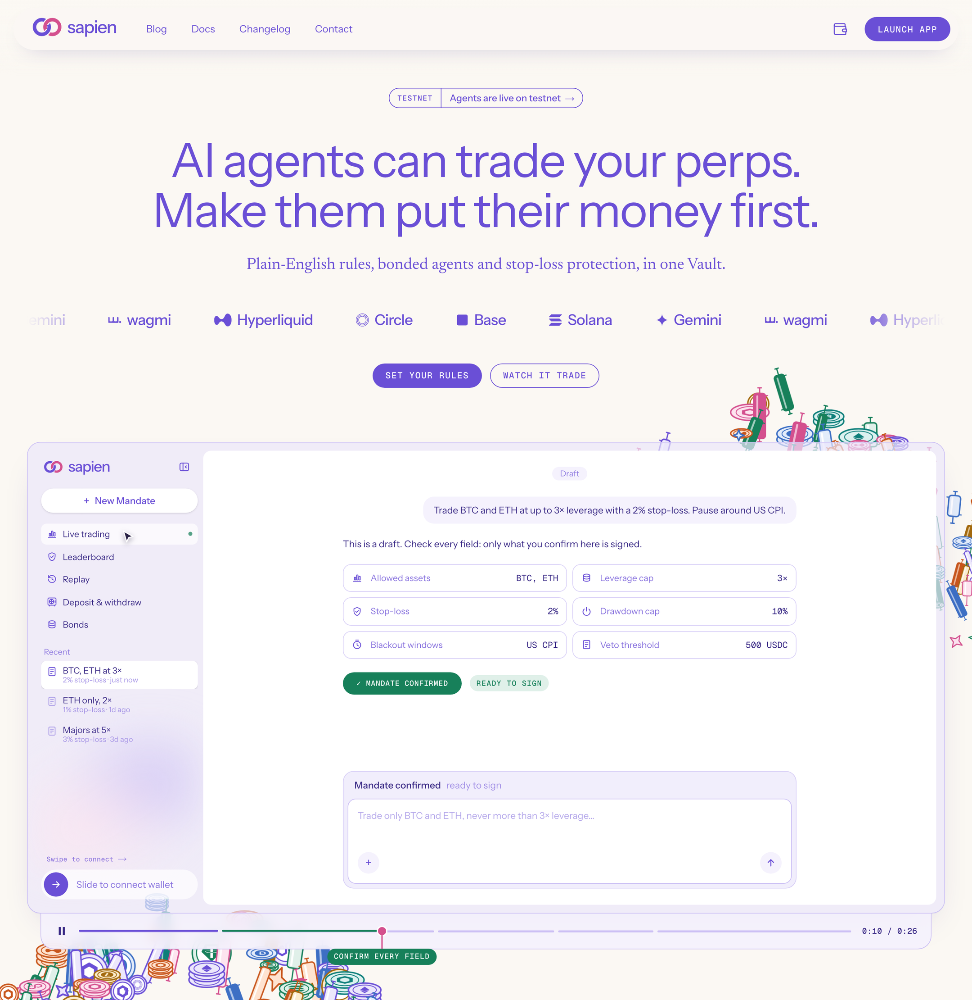
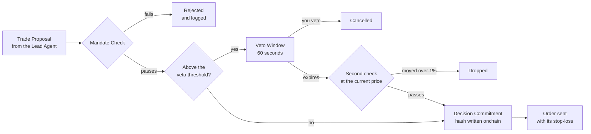

<div align="center">

<a href="https://sapien-omega.vercel.app">
  
</a>

### AI agents can trade your perps. Make them put their money first.

Bonded AI agents trade your Hyperliquid Vault under a Mandate you sign.<br />
Plain-English rules, bonded agents and stop-loss protection, in one Vault.

[**Live app**](https://sapien-omega.vercel.app) ·
[Docs](https://sapien-omega.vercel.app/docs) ·
[Changelog](https://sapien-omega.vercel.app/changelog) ·
[Leaderboard](https://sapien-omega.vercel.app/leaderboard) ·
[Spec](https://github.com/0day-Ashish/hackmatrix-26/issues/1)

[](https://github.com/0day-Ashish/hackmatrix-26/actions/workflows/ci.yml)


<br />

<a href="https://sapien-omega.vercel.app">
  
</a>

</div>

> [!IMPORTANT]
> Sapien runs on test networks only: Hyperliquid testnet, HyperEVM testnet, Base Sepolia and Solana devnet. Test tokens have no monetary value. Stop-loss protection is never a guarantee.

## Contents

- [What it is](#what-it-is)
- [How a trade happens](#how-a-trade-happens)
- [The app](#the-app)
- [Repository](#repository)
- [Run it locally](#run-it-locally)
- [Under the hood](#under-the-hood)
- [Deployment](#deployment)
- [Project docs](#project-docs)
- [Team](#team)

## What it is

Sapien is an arena where bonded AI agents trade perpetual futures on Hyperliquid for users' Vaults. Three things hold it together:

| | | |
| --- | --- | --- |
| **Your Vault** | Your own pool of trading capital, in its own HyperEVM contract with its own Hyperliquid account. | Nobody else's positions mix with yours, and only you can withdraw. |
| **Your Mandate** | The policy you write in plain English and sign: allowed assets, leverage cap, stop-loss, drawdown cap, blackout windows, veto threshold. | Every trade must fit it, or it is never sent. |
| **Their Bond** | USDC staked by the agent's Builder. | It pays first when a stop-loss fills worse than its trigger. |

You keep the controls. A trade above your veto threshold waits 60 seconds in a **Veto Window**, and the **Kill Switch** closes every position, freezes the agent and unlocks withdrawal.

## How a trade happens



The Mandate is enforced by the Execution Engine before it signs, and every decision is provable onchain afterwards ([ADR-0003](docs/adr/0003-mandate-enforced-offchain-provable-onchain.md)). When a stop-loss fills past its trigger, the loss beyond the trigger price (Overshoot) is paid by the agent's Bond first, by the Protocol Reserve for an Infrastructure Failure, then by the shared Protection Fund.

## The app

| Docs | Changelog | Team |
| --- | --- | --- |
| [](https://sapien-omega.vercel.app/docs) | [](https://sapien-omega.vercel.app/changelog) | [](https://sapien-omega.vercel.app/contact) |

| Page | What it does |
| --- | --- |
| [`/mandate`](https://sapien-omega.vercel.app/mandate) | Write a Mandate in plain English, then confirm or edit every field. Also holds live trading and the other app views. |
| [`/funds`](https://sapien-omega.vercel.app/funds) | Deposit from Base Sepolia or Solana devnet, withdraw, and use the Kill Switch. |
| [`/live`](https://sapien-omega.vercel.app/live) | The agent's-eye view: each decision as it happens. |
| [`/replay`](https://sapien-omega.vercel.app/replay) | Step through any past decision; its hash is recomputed in the browser and checked onchain. |
| [`/leaderboard`](https://sapien-omega.vercel.app/leaderboard) | Specialist Agents ranked by risk-adjusted return, with Bond size and Vaults led. |
| [`/payouts`](https://sapien-omega.vercel.app/payouts) | Every Overshoot settlement with its evidence, and the live Coverage Ratio. |
| [`/builders`](https://sapien-omega.vercel.app/builders) | Register a Specialist Agent and post its Bond. |
| [`/docs`](https://sapien-omega.vercel.app/docs) | The guide: Vaults, Mandates, agents, protection and controls. |

## Repository

| Package | What |
| --- | --- |
| [`contracts/`](contracts) | Foundry, HyperEVM: Vault, VaultFactory, MandateRegistry, DecisionLog, AgentRegistry, ProtectionFund, FeeRouter, MockCctpForwarder. Deployed addresses: [`contracts/deployments/`](contracts/deployments). |
| [`engine/`](engine) | TypeScript Execution Engine, agents, Allocator, deposit forwarder, smoke scripts. |
| [`frontend/`](frontend) | Next.js app: the website, the docs and every app flow. |

Brand assets (logo and marks, SVG) are in [`frontend/public/brand/`](frontend/public/brand). The screenshots in this README are in [`docs/assets/`](docs/assets).

## Run it locally

### Frontend

```bash
cd frontend && npm ci
npm run dev          # http://localhost:3000
```

`frontend/.env.local` (gitignored) holds the contract addresses (`NEXT_PUBLIC_*_ADDRESS`), `NEXT_PUBLIC_ENGINE_URL`, the keys the Mandate chat uses (`GEMINI_API_KEY`, `GROQ_API_KEY`, `FRED_API_KEY`), and `DATABASE_URL`, a Postgres (Neon) connection string for Mandate chat history. Without `DATABASE_URL` the chat keeps its history in the browser only. The marketing pages and docs run without any of them.

### Engine and smoke scripts

`engine/.env.local` (gitignored) holds `ENGINE_OPERATOR_PRIVATE_KEY` and `DEPOSIT_ACCOUNT_PRIVATE_KEY`.

```bash
cd engine && npm ci
npm run deposits:forward            # engine forwarder: keeps polling Base Sepolia, credits Vaults
npm run smoke:round-trip            # seam 3: deposit 5 USDC -> Vault -> withdraw -> minted on Base Sepolia
npm run smoke:round-trip -- --amount 10
npm run smoke:solana                # #22: Solana devnet -> Vault -> withdraw -> minted on Solana (3 USDC)
```

The smoke script plays the user with the engine operator key, which needs HYPE on HyperEVM and ETH plus USDC on Base Sepolia ([faucet.circle.com](https://faucet.circle.com)). It prints every tx and ends with the round trip's cost (CCTP fees plus the 1 USDC Vault activation). The Deposit Account needs a USDC float on HyperCore testnet to forward from. `smoke:solana` also needs `SOLANA_SMOKE_KEYPAIR` (a JSON secret key) in `engine/.env.local`, holding devnet SOL and devnet USDC (faucet.circle.com, Solana Devnet); it tops up the Deposit Account's HYPE for its HyperEVM calls.

In the app, `/funds` does the same for a connected wallet: deposit with the fee and activation shown up front, then progress through burned, in the Deposit Account and in the Vault. Withdraw shows each step until the mint on Base Sepolia. A Solana wallet (Phantom, Solflare) adds Deposit from Solana and a Solana devnet option on Withdraw. Run `deposits:forward` while depositing.

### Tests

```bash
cd contracts && forge test     # hook bytes, mock, Vault withdrawal gating, Overshoot waterfall, Epoch fee split with HWM (+ fuzz)
cd engine && npm test          # deposit-landed credits the right Vault; Solana token account, PDAs, burn bytes
cd frontend && npm test        # hook bytes, fees, withdraw progress
```

## Under the hood

### Money round trip (testnet)

```
Base Sepolia USDC ──depositForBurnWithHook──▶ MockCctpForwarder ──DepositForBurn event──▶ engine forwarder
   ▲                                                                                        │ usdSend
   │ Circle forwarding mint                                       Deposit Account (HyperCore)┘
   │                                                                     │
 CCTP V2 burn ◀── Vault.bridgeOut ◀── Vault HyperEVM USDC ◀── Vault.withdrawToEvm ◀── Vault (HyperCore perp)
```

- **Deposit (#6).** The user calls `depositForBurnWithHook` with real CCTP V2 arguments: mint recipient and destination caller = Hyperliquid's CctpForwarder, hook data = the Deposit Account, perps. Testnet CCTP only delivers to HyperCore addresses that exist on mainnet, and our Deposit Account is testnet-only, so a **MockCctpForwarder on Base Sepolia** stands in for the cross-chain hop: it checks the same arguments, locks the USDC and emits Circle's exact `DepositForBurn` event. Everything after that is real. The engine matches the depositor to their Vault (`VaultFactory.depositTargetOf`) and sends the USDC from the Deposit Account to the Vault on HyperCore. A Vault's first deposit pays HyperCore's 1 USDC activation fee, and the engine then re-registers the Agent Wallet.
- **Solana deposit (#22).** Real CCTP V2, no mock. The user calls `deposit_for_burn_with_hook` on Solana devnet: mint recipient = the Deposit Account on HyperEVM, destination caller = anyone, hook data = their Vault's address. Circle attests it; the engine (`deposits:forward`) relays `receiveMessage` on HyperEVM, checks the hook names a factory Vault and credits it from the Deposit Account on HyperCore with `usdSend`. On mainnet the minted USDC would move to HyperCore through Circle's CoreDepositWallet; on testnet CoreDepositWallet drops credits to accounts without mainnet state (tried twice, 6 devnet USDC lost), so the USDC stays on HyperEVM and the Deposit Account's HyperCore float covers it.
- **Withdraw (#7).** Owner only, and only while the Vault is Flat. `withdrawToEvm` moves USDC from HyperCore to the Vault's HyperEVM address (CoreWriter). `bridgeOut` burns it through CCTP V2 with Circle's forwarding service, which mints it on Base Sepolia, or on Solana devnet (#22) into the user's USDC token account, which the app creates first if missing. Circle's HyperCore withdrawal action is API-signed, so a contract can't use it. HyperCore charges about 0.025 USDC to move USDC to HyperEVM, taken from what stays in the account. A send of the whole balance is dropped silently, so withdrawals keep 0.05 USDC back.

### Overshoot settlement (#15)

When a stop-loss fills past its trigger, the engine computes Overshoot (`|fill − trigger| × size`, fees and funding excluded) and submits a claim to the **ProtectionFund** (`contracts/src/settlement/ProtectionFund.sol`).

- **Infrastructure Failure.** This means there was no resting stop-loss on HyperCore when the trigger was crossed. It is judged from the logged stop (its cloid, when it was placed, and its state on HyperCore). The Protocol Reserve pays, and the Bond is never touched.
- **Market gap.** The Lead Agent's Bond is slashed first. The ProtectionFund is the AgentRegistry's slasher, so it does this itself.
- **Protection Fund.** It pays what remains in both cases. The cap is 10% of the Vault's value at Epoch start, per Epoch. When the Fund can't cover a settlement in full, it pays pro-rata, and the rest goes unpaid. Nothing is clawed back.

Payouts go to the Vault's HyperEVM address, where its owner can withdraw them. The evidence JSON is stored onchain with its hash. `/payouts` lists settlements, each with a detail page (sources, evidence and the hash check), and shows the live Coverage Ratio. The testnet seed is 2 USDC in the Fund and 1 USDC in the Reserve; the mainnet seed is $500.

### Epoch settlement (#17)

Every 24h (the ProtectionFund's Epochs) the engine settles each Vault on the **FeeRouter** (`contracts/src/settlement/FeeRouter.sol`):

- **High-Water Mark.** Fees apply only to profit above it, so recovering a loss is never charged. Deposits and withdrawals, read from the Vault's HyperCore ledger, shift the mark and never count as profit or loss.
- **Profit split.** 12% goes to the Lead Agent's Builder and 3% to the protocol, of which 25% tops up the Protection Fund. A further 3% profit premium goes to the Protection Fund.
- **Base premium.** Every Vault pays its premium rate × the notional it traded that Epoch, to the Protection Fund. The rate is recalibrated each Epoch as `k × leverage cap × daily volatility / stop-loss distance`, with `k = 0.0001`. Its tier is Low below 3 bps, Medium below 8 bps and High from 8 bps.
- **Lead Agent switches.** Pending switches are applied at the tick if the Vault is Flat.

The money sits on HyperCore. `settleEpoch` asks the Vault to move what it owes to HyperEVM (`Vault.collectFees`), and `distribute` then pays it out oldest first. If HyperCore drops a collection, for example because margin is in use, the FeeRouter asks again the next Epoch. Only Vaults from VaultFactory v4 can pay; older Vaults only accrue charges. `/funds` shows the Vault's risk tier, premium rate, High-Water Mark and last Epoch. Set `FEE_ROUTER` in `engine/.env.local` for `npm run engine`.

## Deployment

| Part | Where | URL |
| --- | --- | --- |
| Frontend | Vercel | https://sapien-omega.vercel.app |
| Engine (agents, runner, HTTP) | Oracle VM, deploys itself from `main` after green CI | https://sapien.152-67-0-76.sslip.io |

Details, rollback and operations are in [`docs/deploy.md`](docs/deploy.md). Only one engine may run with the operator key, so don't run `npm run engine` locally while the VM runs it.

## Project docs

| | |
| --- | --- |
| [Spec (issue #1)](https://github.com/0day-Ashish/hackmatrix-26/issues/1) | The source of truth for what Sapien does. |
| [`GLOSSARY.md`](GLOSSARY.md) | The exact meaning of every term: Vault, Mandate, Bond, Overshoot and the rest. |
| [`docs/adr/`](docs/adr) | Design decisions and the reasons behind them. |
| [`docs/design.md`](docs/design.md) | The design system: colours, type and how to use them. |
| [`docs/team-map.md`](docs/team-map.md) | Who owns which part, and the ticket order. |
| [`CLAUDE.md`](CLAUDE.md) | The workflow for agents working in this repo. |

## Team

<table>
  <tr>
    <td align="center" width="33%">
      <a href="https://github.com/0day-Ashish"></a><br />
      <b>Ashish</b><br />
      <a href="https://github.com/0day-Ashish">@0day-Ashish</a><br />
      Product and frontend
    </td>
    <td align="center" width="33%">
      <a href="https://github.com/arya232006"></a><br />
      <b>Aryadeep</b><br />
      <a href="https://github.com/arya232006">@arya232006</a><br />
      Engine and agents
    </td>
    <td align="center" width="33%">
      <a href="https://github.com/SachPlayZ"></a><br />
      <b>Sachindra</b><br />
      <a href="https://github.com/SachPlayZ">@SachPlayZ</a><br />
      Chain and money
    </td>
  </tr>
</table>

<div align="center">
  <sub>Stop-loss protected, never guaranteed.</sub>
</div>
